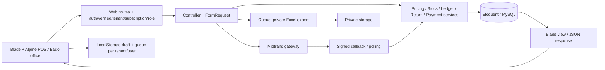

> Laporan ini merekam kondisi sebelum perbaikan. Status implementasi terbaru ada di [REMEDIATION_2026-10-26.md](REMEDIATION_2026-10-26.md).

# Audit menyeluruh pos-saas / GrowPOS

**Tanggal:** 25 Oktober 2026, Asia/Jakarta. **Mode:** analisis, pengujian aman, dan rekomendasi; tanpa perubahan source code bisnis. **Artefak:** laporan, bukti JSON, contoh probe, peta workflow dan screenshot.

## 1. Executive Summary

**Verdict: belum siap untuk peluncuran produksi tanpa pembatasan.** Fondasi POS sudah cukup kuat untuk dilanjutkan: harga dihitung ulang di server, checkout menggunakan transaksi dan referensi idempoten, kas memiliki ledger, stok/biaya/unit jual disnapshot, akses tenant dan role banyak dilindungi tes. Stack monolit Laravel + Blade + Alpine sesuai skala produk ini; tidak diperlukan rewrite framework atau microservices.

Penghambat utama ada pada integritas billing dan inventory, serta output HTML yang tidak aman. Webhook bisa membuat invoice lunas tanpa subscription; tab edit katalog dan opname yang memakai hasil hitung lama dapat mengembalikan stok yang sudah terjual. Registry juga melaporkan advisory critical/high pada dependensi terkunci. UI telah memiliki identitas hijau yang konsisten dan workspace kasir yang fokus. Perbaikan sebagian pada navigasi katalog, aksesibilitas, istilah dan responsive lebih tepat daripada redesign total.

Audit menghasilkan **26 temuan: 21 temuan dengan bukti kode/pengujian (dengan batas verifikasi masing-masing), 4 dugaan risiko, dan 1 rekomendasi subjektif**. Prioritas P0 di laporan ini mengikuti definisi yang diminta: keamanan/integritas data/fungsi inti rusak; berbeda dari skala P1/P2 pada ringkasan audit awal. Skor bukan sertifikasi dan tidak dirata-ratakan menjadi angka kesiapan semu.

### Bukti eksekusi

| Pemeriksaan | Hasil dan interpretasi |
|---|---|
| Full PHP suite | **105 tes, 103 lolos, 2 gagal, 862 assertions**; dua kegagalan dijelaskan pada F12 |
| JavaScript | **17/17 lolos**; formatter, state, scanner, persistence dan recovery |
| Build produksi | Berhasil; bundle JS 119.995 byte, CSS 100.483 byte |
| Formatting | Prettier check lolos |
| PHP syntax | **233 file, nol error sintaks** |
| Probe khusus | **10/10 probe mereproduksi perilaku bermasalah**, 31 assertions; bukan acceptance test untuk perilaku benar |
| Smoke route | **114 request GET = 38 halaman × 3 role**, nol HTTP 500 pada cakupan halaman daftar/create yang diuji; redirect/403 tercatat dan bukan dianggap kegagalan |
| Browser E2E terbatas | Login owner → buka shift → pilih 1,5 kg → tunai Rp22.500 → receipt → stok 18,5 kg dan kas Rp22.500; logout berhasil |
| Responsive | Delapan halaman representatif × tujuh viewport; 320, 375, 390, 768, 1024, 1440, 1920px. Bukan seluruh 106 template pada setiap ukuran |
| Dependency PHP | **47 advisory / 14 paket produksi**, severity registry: 2 critical, 17 high, 23 medium, 3 low, 2 tanpa severity |
| Dependency npm | **8 paket terdampak**, termasuk rantai dependency: 2 critical, 3 high, 3 moderate; bukan delapan exploit aplikasi yang terbukti |

Probe dan browser memakai **SQLite terisolasi/synthetic data**; database aplikasi tidak dimigrasi atau diubah. Kredensial gateway dikosongkan dalam preview, email memakai array transport dan queue preview memakai sync. Tidak ada pembayaran, email, deployment, atau pengajuan keuangan nyata. File `.env` tidak dibuka/disalin; konfigurasi diperiksa dari source/default dan hasil nonrahasia. Runtime Laravel dapat memuat konfigurasi lokal, tetapi nilainya tidak dicetak.

### Discovery dan hubungan sistem

Inventaris first-party: **128 file PHP aplikasi, 106 Blade template, 46 migration, 31 file tes PHP**, ditambah enam modul JavaScript aplikasi dan empat file tes JS. Dependency vendor tidak diaudit source-per-source; advisory registry dijalankan pada lock.

| Lapisan | Implementasi yang ditemukan |
|---|---|
| Runtime/backend | PHP constraint ^8.3; runtime audit PHP 8.5.0; Laravel locked v13.8.0 |
| Frontend | Blade SSR, Alpine.js locked 3.17.4, Tailwind 3.4.19, Vite 8.3.0; axios locked 1.20.0 |
| ORM/database | Eloquent; MySQL sasaran operasional, SQLite in-memory untuk suite dan SQLite file sementara untuk preview |
| Auth | Session auth/Breeze-style controllers, email verification, Google Socialite; Sanctum terpasang namun API bisnis publik terautentikasi token tidak terbukti tersedia |
| Authorization | Kolom role admin/manager/kasir, middleware role, gates entitlement dan is_platform_admin; Spatie permission terpasang tetapi enforcement utama terlihat melalui role/gates |
| Tenant | users.tenant_id aktif; ownership tenants.user_id; global scope kondisional + filter eksplisit; background jobs wajib tenant eksplisit |
| Pembayaran | Midtrans CoreApi QRIS POS dan Snap billing; dua implementasi aktivasi billing yang tidak konsisten |
| Services | OrderPricing, RetailQuantity, RecipeStock, OrderStock, CashLedger, OrderReturnService, OrderPaymentService, CustomerPoints |
| Async | ExportReportJob, RecordWorkerHeartbeat; driver default database; preview/testing sync |
| Scheduler | Rekonsiliasi tiap menit, heartbeat tiap menit, backup harian 02:00 menurut timezone aplikasi |
| Observability | Logging Laravel, integrasi Sentry, launch-check, heartbeat dan command restore/concurrency; operasional server belum diinspeksi |
| Deployment | Shell in-place: git pull → Composer no-dev → npm ci/build → clear/migrate/optimize → queue restart |

Alur normal mempunyai pemisahan yang cukup jelas. Titik debt utama: billing masih menaruh state transition di dua controller, katalog menggabungkan perubahan identitas produk dan stok, query metrik tersebar, serta modal legacy berbeda dari POS. Laravel menyediakan transaksi yang sesuai untuk menyatukan perubahan terkait tanpa menambah infrastruktur baru. [Dokumentasi transaksi Laravel 13](https://laravel.com/framework/docs/13.x/database#database-transactions).

### Cakupan 13 fase dan batasnya

| Fase | Bukti yang dipakai | Batas |
|---|---|---|
| 01 Discovery/architecture | Inventaris, routes, middleware, models/services, config, lock, scheduler | Bukan audit seluruh source vendor |
| 02 Frontend | Seluruh modul JS, komponen/layout, Blade modul, DOM/screenshot dan JS tests | Tidak setiap handler lama dieksekusi browser |
| 03 Backend | Controller/request/service, transaksi/status, exception dan tests | Race MySQL nyata belum dijalankan |
| 04 Database | 46 migration, relasi/constraint, akses tenant, ledger dan probe | Tidak membaca data merchant, EXPLAIN atau statistik MySQL produksi |
| 05 UI | Landing/login/dashboard/POS/katalog/form/CRM/report/PO/billing/menu/settings/staf | Penilaian visual subjektif, tanpa wawancara pengguna |
| 06 UX/accessibility | Form labels, dialog, keyboard Escape, feedback dan mobile | Belum screen reader penuh, contrast scan seluruh warna, 200–400% zoom/RTL |
| 07 Flow | 26 peta workflow dan trace state | Source map bukan klaim semua alur lulus E2E |
| 08 Security | Auth/role/tenant/CSRF/XSS, upload, private exports, advisory | Bukan pentest infrastruktur atau eksploitasi berbahaya |
| 09 Performance | Bundle/media bytes dan query/time fixture | LCP/INP/CLS lapangan, p95 API dan beban nyata **N/A** |
| 10 Responsive | Delapan halaman utama pada tujuh ukuran | Tidak seluruh halaman/detail/modal pada semua device |
| 11 QA | PHP/JS/syntax/build/format/probe/smoke/browser cash checkout | Tidak ada metrik coverage persentase; live integrations/hardware N/A |
| 12 Product | Terminologi, bon/refund/jasa/outlet, perbandingan alur | Kebutuhan merchant nyata perlu validasi product |
| 13 DevOps | deploy/config/backup/restore commands/Sentry/heartbeat | SSH, TLS, worker, offsite backup dan restore drill nyata belum diverifikasi |

## 2. Project Health Scorecard

Rubrik: 0–2 fungsi mendasar gagal; 3–4 blocker besar; 5–6 fungsi tersedia dengan debt/risiko material; 7–8 baik pada bukti yang diuji; 9–10 memerlukan bukti luas dan operasional matang. **N/A berarti bukti tidak cukup**, bukan skor nol. Skor UI/UX adalah penilaian profesional berbasis sampel visual, bukan hasil riset pengguna.

| Aspek | Skor /10 | Prioritas | Dasar penilaian |
|---|---:|---|---|
| Frontend | 6 | P1 | State recovery/formatter teruji; pagination katalog, label dan modal masih bermasalah |
| Backend | 5 | P0 | POS services/transactions baik, billing dan stale stock overwrite menghambat |
| Architecture | 6 | P1 | Monolit tepat, services jelas; state billing/metrik dan legacy flow perlu disatukan |
| Database | 6 | P0 | Ledger, decimal quantity, snapshot/unique keys baik; lost update, missing FK dan delete/context risk |
| UI Design | 7 | P2/P3 | Identitas, whitespace, CTA dan kasir fokus sudah baik; PO/generic forms dan sidebar kurang konsisten |
| UX & Usability | 5 | P1 | Receipt/recovery jelas; katalog >10 item dan aksesibilitas back-office menghalangi tugas |
| Website Flow | 5 | P0 | Sale→stock→cash tersambung; billing, CRM detail dan stock counting terputus |
| Security | 4 | P0/P1 | Role/CSRF/tenant guards teruji, tetapi HTML unsafe, inactive status dan advisory perlu ditutup |
| Performance | N/A | P2 | Ukuran asset/query tersedia; tidak cukup bukti untuk menilai CWV/kapasitas produksi |
| Responsive | 7 | P2 | Halaman representatif tidak root overflow pada tujuh lebar; report 320px dan header scroll perlu perbaikan |
| Testing | 6 | P1 | 122 tes PHP+JS tersedia; 2 gagal dan gap billing/lost update/withdrawal/E2E masih besar |
| Production Readiness | 3 | P0 | Blocker data/payment/security terbuka; deployment/restore/live readiness belum terbukti |

## 3. Detailed Findings

Effort adalah estimasi person-days untuk engineer yang memahami Laravel, **bukan komitmen waktu**. S ≤1 hari, M sekitar 1–3 hari, L beberapa hari atau lebih. Perbaikan yang berbagi service sebaiknya digabung agar estimasi tidak dijumlahkan mentah. Bukti JSON ada di [folder audit](/Users/ferdy/project-fl/pos-saas/docs/audit-2026-10-25/).

### F01 — Webhook melunaskan invoice tanpa mengaktifkan langganan

**Kategori:** Billing / integritas bisnis · **Prioritas:** P0 · **Bukti:** Terverifikasi — probe HTTP

**Lokasi:** [app/Http/Controllers/PaymentCallbackController.php:78](/Users/ferdy/project-fl/pos-saas/app/Http/Controllers/PaymentCallbackController.php:78)

**Masalah/penyebab:** Invoice baru dibuat dengan subscription_id null; callback hanya mencari subscription lama melalui ID tersebut. checkStatus langsung berhenti jika invoice sudah paid.

**Dampak:** Merchant sudah membayar namun akses operasional tetap terkunci; polling tidak memulihkan kondisi ini.

**Bukti:** Probe webhook bertanda tangan valid: invoice paid, subscription tetap nol, currentPlan null. Lihat AuditProbeTest.php.example dan probe-results.json.

**Solusi konkret:** Gunakan satu BillingPaymentService untuk webhook dan polling: lock tenant/invoice, validasi pembayaran, buat atau perpanjang subscription dari invoice.plan_id, dan tandai paid dalam transaksi yang sama. Tambahkan rekonsiliasi invoice paid tanpa subscription.

**Kompleksitas/effort:** M (2–3 hari). **Risiko regresi:** Tinggi: perpanjangan, upgrade dan invoice historis; uji urutan callback/polling serta invoice lama.

### F02 — HTML tersimpan masuk langsung ke innerHTML riwayat bahan

**Kategori:** Security / frontend · **Prioritas:** P0 · **Bukti:** Terverifikasi — source-to-sink dan marker HTML di browser

**Lokasi:** [resources/views/material/index.blade.php:411](/Users/ferdy/project-fl/pos-saas/resources/views/material/index.blade.php:411)

**Masalah/penyebab:** Catatan mutasi dan nama supplier diinterpolasikan ke template HTML; catatan juga masuk atribut title tanpa encoding.

**Dampak:** Manager dapat menyimpan markup yang dibaca admin. Sink ini memungkinkan stored XSS dalam sesi tenant; eksekusi skrip berbahaya sengaja tidak dicoba.

**Bukti:** Marker inert <b data-audit-marker="stored-html">Audit markup</b> menjadi elemen DOM di #historyContent, bukan teks literal. Screenshot material-history-390.jpg dan pemeriksaan DOM browser.

**Solusi konkret:** Bangun DOM memakai textContent dan setAttribute untuk data pengguna; jika format HTML diperlukan, gunakan sanitizer allowlist. Uji karakter kutip dan markup pada note serta supplier.

**Kompleksitas/effort:** S (0,5–1 hari). **Risiko regresi:** Rendah–sedang: tampilan histori/tooltip; gunakan regression DOM test.

### F03 — Advisory critical/high pada dependency produksi dan tooling

**Kategori:** Security / supply chain · **Prioritas:** P1 · **Bukti:** Terverifikasi — registry advisory, exploitability aplikasi belum dibuktikan

**Lokasi:** [composer.lock](/Users/ferdy/project-fl/pos-saas/composer.lock)

**Masalah/penyebab:** Versi terkunci tertinggal dari patch keamanan yang tercatat pada registry saat audit.

**Dampak:** Permukaan risiko framework, HTTP client, parsing spreadsheet dan tooling build; dampak nyata bergantung pada jalur API yang digunakan.

**Bukti:** Composer --locked: 47 advisory pada 14 paket produksi (2 critical, 17 high, 23 medium, 3 low, 2 tanpa severity). npm: 8 paket terdampak (2 critical, 3 high, 3 moderate). JSON lengkap tersimpan; jumlah paket bukan jumlah exploit.

**Solusi konkret:** Update secara bertahap berdasarkan advisory dan dependency tree, uji parser/import, auth, report dan checkout. Tinjau override patch transitif sebelum migrasi besar Tailwind. Jangan memakai audit fix --force tanpa review.

**Kompleksitas/effort:** M–L (2–5 hari). **Risiko regresi:** Sedang–tinggi: perubahan dependency, impor Excel, bundling dan framework.

### F04 — Polling billing dapat memperpanjang subscription dua kali

**Kategori:** Billing / concurrency · **Prioritas:** P1 · **Bukti:** Terverifikasi — simulasi deterministik stale instance

**Lokasi:** [app/Http/Controllers/SubscriptionController.php:220](/Users/ferdy/project-fl/pos-saas/app/Http/Controllers/SubscriptionController.php:220)

**Masalah/penyebab:** Status paid diperiksa dari instance invoice lama, tanpa transaksi dan row lock pada pembaruan subscription.

**Dampak:** Dua request pending untuk pembayaran yang sama dapat menggandakan durasi atau membuat subscription ganda.

**Bukti:** Dua instance invoice yang sama-sama pending diproses berurutan untuk mensimulasikan interleaving; end_date bertambah lagi pada invocation kedua. Bukan load test MySQL paralel.

**Solusi konkret:** Satukan dengan F01, reread status di dalam lock, catat satu aktivasi per invoice. Uji callback/polling bersamaan pada MySQL terisolasi.

**Kompleksitas/effort:** S jika digabung F01. **Risiko regresi:** Tinggi: invariant satu pembayaran/satu aktivasi.

### F05 — Handler polling tidak memeriksa fraud, identitas dan nominal

**Kategori:** Billing / payment validation · **Prioritas:** P1 · **Bukti:** Terverifikasi — probe langsung handler

**Lokasi:** [app/Http/Controllers/SubscriptionController.php:225](/Users/ferdy/project-fl/pos-saas/app/Http/Controllers/SubscriptionController.php:225)

**Masalah/penyebab:** Semua capture diterima sebagai paid; handler tidak membandingkan order_id/gross_amount dengan invoice.

**Dampak:** Jalur aktivasi tidak memiliki invariant yang sama dengan callback; capture dengan fraud challenge dapat mengaktifkan paket.

**Bukti:** Fixture respons capture/challenge dengan gross_amount berbeda tetap menghasilkan invoice paid. Probe memanggil handler internal; ini bukan bukti penyerang dapat memasok respons gateway dari request publik.

**Solusi konkret:** Gunakan validasi final settlement atau capture+accept, cocokkan order_id dan nominal, dan abaikan state nonfinal; gunakan service F01.

**Kompleksitas/effort:** S (0,5–1 hari). **Risiko regresi:** Sedang: perubahan state provider; uji respons final/nonfinal.

### F06 — Status inactive tidak menghentikan sesi operasional

**Kategori:** Authentication / authorization · **Prioritas:** P1 · **Bukti:** Terverifikasi — probe HTTP sesi inactive

**Lokasi:** [app/Http/Requests/Auth/LoginRequest.php:45](/Users/ferdy/project-fl/pos-saas/app/Http/Requests/Auth/LoginRequest.php:45)

**Masalah/penyebab:** Login hanya memeriksa email/password; middleware role/tenant/subscription tidak memeriksa status user.

**Dampak:** Akun yang dinonaktifkan melalui database masih dapat memakai sesi operasional.

**Bukti:** User inactive terautentikasi memperoleh HTTP 200 pada /pos. Pemeriksaan source menunjukkan OAuth tidak memiliki guard status.

**Solusi konkret:** Periksa active saat login dan melalui middleware untuk sesi yang sudah ada; konsisten pada OAuth, invalidasi sesi bila dinonaktifkan. Tambahkan aksi suspend staf yang aman.

**Kompleksitas/effort:** S–M (1–2 hari). **Risiko regresi:** Sedang: jangan mengunci akun pemilik secara tidak sengaja; uji sesi lama.

### F07 — Paket nonaktif/nonpublik dapat diaktifkan lewat POST

**Kategori:** Authorization / entitlement · **Prioritas:** P1 · **Bukti:** Terverifikasi — probe HTTP

**Lokasi:** [app/Http/Controllers/SubscriptionController.php:40](/Users/ferdy/project-fl/pos-saas/app/Http/Controllers/SubscriptionController.php:40)

**Masalah/penyebab:** Daftar paket memfilter is_active/is_public, tetapi subscribe hanya memvalidasi exists:plans,id.

**Dampak:** Paket internal atau dinonaktifkan dapat dibeli/diaktifkan oleh tenant yang mengetahui ID; dampak sesuai data paket yang tersedia.

**Bukti:** Paket gratis fixture is_active=false dan is_public=false berhasil menghasilkan subscription aktif.

**Solusi konkret:** Validasi eligibility server-side. Paket privat memerlukan allowlist tenant yang eksplisit; tetap izinkan menyelesaikan invoice sah yang dibuat sebelum paket dinonaktifkan sesuai kebijakan bisnis.

**Kompleksitas/effort:** S (0,5 hari). **Risiko regresi:** Rendah–sedang: kontrak paket privat/invoice lama.

### F08 — Penyelesaian opname menimpa mutasi selama penghitungan

**Kategori:** Inventory / data integrity · **Prioritas:** P0 · **Bukti:** Terverifikasi — probe workflow

**Lokasi:** [app/Http/Controllers/StocktakeController.php:56](/Users/ferdy/project-fl/pos-saas/app/Http/Controllers/StocktakeController.php:56)

**Masalah/penyebab:** Snapshot system_quantity disimpan, tetapi complete mengganti stock dengan counted_quantity tanpa memeriksa mutasi sejak hitung.

**Dampak:** Stok dapat kembali naik setelah barang terjual; potensi oversell dan selisih fisik.

**Bukti:** Stok 10 → opname/hitung 10 → penjualan 1 menghasilkan 9 → complete hitung lama 10 menghasilkan stok 10.

**Solusi konkret:** Pilih kebijakan sederhana: freeze SKU saat dihitung atau cek versi/waktu dan minta recount jika berubah. Jangan otomatis menerapkan delta tanpa definisi waktu hitung yang jelas.

**Kompleksitas/effort:** M (1–2 hari). **Risiko regresi:** Tinggi: inventory dan checkout; uji sales/receive/return selama opname.

### F09 — Halaman detail pelanggan merujuk view yang hilang

**Kategori:** CRM / broken flow · **Prioritas:** P1 · **Bukti:** Terverifikasi — HTTP 500

**Lokasi:** [app/Http/Controllers/CustomerController.php:106](/Users/ferdy/project-fl/pos-saas/app/Http/Controllers/CustomerController.php:106)

**Masalah/penyebab:** Route customers.show tersedia tetapi resources/views/customers/show.blade.php tidak ada.

**Dampak:** Direct link detail pelanggan gagal; riwayat belanja/piutang per pelanggan tidak bisa diselesaikan melalui route ini.

**Bukti:** Probe customer tenant valid menghasilkan 500; view()->exists("customers.show") false. Smoke 114 halaman daftar tidak mencakup detail ini.

**Solusi konkret:** Implementasikan detail pelanggan dengan transaksi dan piutang tenant-scoped, atau tutup route jika fitur belum didukung; tambahkan feature test render/detail.

**Kompleksitas/effort:** S–M (1–2 hari). **Risiko regresi:** Rendah–sedang: izin role dan data pelanggan.

### F10 — Angka AI memasukkan unpaid/cancelled dan berbeda basis tanggal

**Kategori:** Analytics / business correctness · **Prioritas:** P1 · **Bukti:** Terverifikasi — inspeksi query; gateway AI tidak dipanggil

**Lokasi:** [app/Http/Controllers/AiReportController.php:42](/Users/ferdy/project-fl/pos-saas/app/Http/Controllers/AiReportController.php:42)

**Masalah/penyebab:** Query index tren/top/bottom/growth tidak memfilter paid/completed dan memakai created_at; laporan finansial memakai sold_at fallback created_at.

**Dampak:** Rekomendasi bisnis dapat memakai omzet semu dari QR gagal, bon dan pembatalan; angka tidak cocok antarhalaman.

**Bukti:** Perbandingan query AiReportController dengan ReportController. Jalur chat memiliki sebagian filter paid, tetapi bukan dataset yang sama di seluruh agregat.

**Solusi konkret:** Satu query builder/dataset transaksi untuk dashboard/report/AI. Definisikan penjualan sebelum retur, kas aktual dan piutang sebagai metrik berbeda dengan periode jelas.

**Kompleksitas/effort:** M (1–2 hari). **Risiko regresi:** Sedang: perubahan definisi metrik dan cache; uji fixture unpaid/cancelled/sold_at.

### F11 — HTML keluaran AI dirender tanpa sanitizer

**Kategori:** Security / generated content · **Prioritas:** P1 · **Bukti:** Terverifikasi — sink raw HTML; exploit model end-to-end belum diuji

**Lokasi:** [resources/views/reports/ai-analysis.blade.php:232](/Users/ferdy/project-fl/pos-saas/resources/views/reports/ai-analysis.blade.php:232)

**Masalah/penyebab:** Output model dicache dan dicetak melalui Blade raw HTML; instruksi prompt bukan sanitasi.

**Dampak:** Output yang mengandung script/atribut berbahaya dapat menjadi XSS; nama produk masuk prompt dan dapat memengaruhi output.

**Bukti:** AiReportController menyimpan respons tanpa sanitasi lalu view menggunakan {!! $aiAnalysis !!}. Chat strip_tags tidak melindungi laporan HTML ini.

**Solusi konkret:** Sanitasi allowlist sebelum cache/render, atau render data terstruktur/Markdown dengan HTML dinonaktifkan. Hapus cache lama setelah perubahan.

**Kompleksitas/effort:** S–M (1 hari). **Risiko regresi:** Sedang: tabel/format laporan harus tetap terbaca.

### F12 — Dua tes existing gagal

**Kategori:** QA / regression · **Prioritas:** P2 · **Bukti:** Terverifikasi — full test suite

**Lokasi:** [tests/Feature/LandingPageTest.php:15](/Users/ferdy/project-fl/pos-saas/tests/Feature/LandingPageTest.php:15)

**Masalah/penyebab:** Teks landing berubah dari kontrak tes; ilustrasi auth memakai style inline yang dilarang TailwindAssetsTest.

**Dampak:** Baseline CI tidak hijau; perubahan berikutnya sulit dibedakan dari kegagalan lama. Ini bukan bukti landing tidak tampil.

**Bukti:** 105 tes: 103 lolos, 2 gagal, 862 assertions. TailwindAssetsTest.php:12 menunjuk components/auth/shell.blade.php. Hasil JSON tersimpan.

**Solusi konkret:** Selaraskan kontrak konten yang disepakati dan aturan ilustrasi; gunakan kelas statis bila aturan no-inline-style dipertahankan. Jangan menghapus assertion bermakna hanya agar hijau.

**Kompleksitas/effort:** S (0,5 hari). **Risiko regresi:** Rendah.

### F13 — Katalog terhenti setelah 10 item dan ringkasan hanya satu halaman

**Kategori:** Frontend / workflow / data presentation · **Prioritas:** P1 · **Bukti:** Terverifikasi — probe dan browser dataset 12 produk

**Lokasi:** [resources/views/products/index.blade.php:93](/Users/ferdy/project-fl/pos-saas/resources/views/products/index.blade.php:93)

**Masalah/penyebab:** Controller paginate(10), tetapi view tidak merender links() atau input search. KPI memakai count/filter pada collection halaman aktif.

**Dampak:** Produk di halaman berikutnya tidak bisa ditemukan lewat kontrol UI; judul Total Item Produk menampilkan 10 meskipun kuota menyebut 12. Jumlah stok aman/kritis tidak mewakili seluruh katalog.

**Bukti:** Probe 11 produk: total=11, count=10, tidak ada page=2 atau name=search di respons. Browser 12 produk menampilkan Total 10, kuota 12.

**Solusi konkret:** Tambahkan pencarian, pagination withQueryString, indikator rentang, dan agregat seluruh tenant atau label eksplisit hanya halaman ini. Gunakan satu empty state untuk pencarian kosong.

**Kompleksitas/effort:** S (1 hari). **Risiko regresi:** Rendah: query/filter/pagination perlu regression test.

### F14 — Edit katalog dari form lama dapat mengembalikan stok yang sudah terjual

**Kategori:** Inventory / lost update · **Prioritas:** P0 · **Bukti:** Terverifikasi — probe workflow

**Lokasi:** [app/Http/Controllers/ProductController.php:132](/Users/ferdy/project-fl/pos-saas/app/Http/Controllers/ProductController.php:132)

**Masalah/penyebab:** ProductRequest memasukkan stock ke payload edit; lock hanya melindungi commit, bukan snapshot saat form dibuka.

**Dampak:** Perubahan nama/harga dari tab lama dapat membatalkan pengurangan stok penjualan. Movement adjustment tercatat, tetapi jumlah fisik tetap salah.

**Bukti:** Produk stock 10 → checkout stock 9 → PUT rename dengan stock lama 10 → stock kembali 10. ExtendedAuditProbeTest.php.example.

**Solusi konkret:** Pisahkan edit katalog dari mutasi stok. Gunakan endpoint inventory yang sudah ada; jika stock harus dapat diedit, minta versi stok dan alasan eksplisit serta tolak stale version.

**Kompleksitas/effort:** M (1–2 hari). **Risiko regresi:** Tinggi: edit produk, impor dan stok; uji perubahan katalog setelah penjualan.

### F15 — Pengiriman ulang withdrawal mendebit saldo dua kali

**Kategori:** Finance / idempotency · **Prioritas:** P1 · **Bukti:** Terverifikasi — probe HTTP

**Lokasi:** [app/Http/Controllers/FinanceController.php:50](/Users/ferdy/project-fl/pos-saas/app/Http/Controllers/FinanceController.php:50)

**Masalah/penyebab:** Kolom idempotency_key sudah ada, tetapi controller tidak memvalidasi/menyimpannya dan frontend hanya mengirim amount. Lock saldo mencegah saldo minus, bukan duplikasi aksi.

**Dampak:** Retry setelah respons hilang atau dua tab membuat dua pengajuan pending serta menahan saldo dua kali; bukan bukti transfer bank dua kali.

**Bukti:** Dua POST amount 10000 dengan key sama menghasilkan dua request dan saldo 100000 → 80000. Extended probe.

**Solusi konkret:** Key stabil per intent, unique tenant/key, bandingkan payload dan kembalikan pengajuan yang sama saat replay. Pertahankan lock wallet dan snapshot rekening.

**Kompleksitas/effort:** S–M (1 hari). **Risiko regresi:** Sedang: recovery request lama dan reject/refund wallet.

### F16 — Form dan modal back-office belum konsisten aksesibel

**Kategori:** Accessibility / UX · **Prioritas:** P1 · **Bukti:** Terverifikasi — DOM, keyboard dan screenshot

**Lokasi:** [resources/views/material/index.blade.php](/Users/ferdy/project-fl/pos-saas/resources/views/material/index.blade.php)

**Masalah/penyebab:** Form produk/pengaturan/report memiliki field tanpa label yang terhubung. Modal riwayat bahan tanpa role dialog, fokus tetap di tombol belakang, Escape tidak menutup. Tombol hamburger mobile tanpa accessible name.

**Dampak:** Pengguna screen reader/keyboard sulit mengenali input dan konteks modal; perilaku berbeda dari POS yang sudah memiliki dialog/inert/focus trap.

**Bukti:** Browser: product_name/category/type/stock tidak mempunyai associated label; tanggal laporan juga demikian. Modal history role null, Escape tetap visible. Lihat browser-page-audit.json dan screenshot modal.

**Solusi konkret:** Hubungkan label/for/id atau aria-label, error aria-describedby, nama tombol, fokus masuk/kembali dan Escape. Gunakan satu primitive modal yang mengikuti pola POS tanpa menyalin seluruh state-nya.

**Kompleksitas/effort:** M (2–3 hari). **Risiko regresi:** Sedang: focus trap, modal nesting, keyboard/touch; uji manual dan otomatis.

### F17 — Filter tanggal laporan melebar pada viewport 320px

**Kategori:** Responsive / usability · **Prioritas:** P2 · **Bukti:** Terverifikasi — browser setelah reload stabil

**Lokasi:** [resources/views/reports/index.blade.php](/Users/ferdy/project-fl/pos-saas/resources/views/reports/index.blade.php)

**Masalah/penyebab:** Dua input tanggal dan separator tidak cukup fleksibel untuk lebar konten sempit.

**Dampak:** Input tanggal akhir terpotong/memerlukan scroll horizontal kecil di main; root tidak overflow sehingga pemeriksaan root saja melewatkannya.

**Bukti:** 320px: main clientWidth 314, scrollWidth 327 setelah reload; screenshot reports-320.jpg. Pada 375–1920px hasil reload tidak menunjukkan overflow main.

**Solusi konkret:** Tumpuk tanggal pada layar terkecil atau grid minmax(0,1fr), w-full/min-w-0; beri label Mulai/Sampai sekaligus memperbaiki F16.

**Kompleksitas/effort:** S (0,5 hari). **Risiko regresi:** Rendah: uji tujuh ukuran dan filter tanggal.

### F18 — Bahasa dokumen public/auth tidak sesuai konten

**Kategori:** Accessibility / localization · **Prioritas:** P2 · **Bukti:** Terverifikasi — DOM browser lokal; produksi belum diperiksa

**Lokasi:** [resources/views/layouts/guest.blade.php:2](/Users/ferdy/project-fl/pos-saas/resources/views/layouts/guest.blade.php:2)

**Masalah/penyebab:** lang memakai locale aplikasi dan fixture mewarisi en; konten landing/login berbahasa Indonesia.

**Dampak:** Pelafalan screen reader dapat salah; tanggal Inggris/Indonesia dan label role Superadmin juga tidak konsisten.

**Bukti:** DOM landing/login: lang=en di seluruh tujuh viewport. Back-office memakai lang=id. Navbar memberi label Superadmin kepada admin toko meski hak platform-admin terpisah.

**Solusi konkret:** Tetapkan locale id untuk konten Indonesia atau lang per halaman; label role Pemilik/Admin Toko dan Admin Platform sesuai izin sebenarnya. BCRYPT adalah hashing, bukan enkripsi; benahi copy profil.

**Kompleksitas/effort:** S (0,5 hari). **Risiko regresi:** Rendah: format tanggal/translasi perlu ditinjau.

### F19 — Aset landing besar dan tidak memiliki varian responsif

**Kategori:** Performance / media · **Prioritas:** P2 · **Bukti:** Terverifikasi — ukuran file dan markup; dampak LCP belum diukur

**Lokasi:** [resources/views/landing.blade.php](/Users/ferdy/project-fl/pos-saas/resources/views/landing.blade.php)

**Masalah/penyebab:** Hero memakai PNG sekitar 2 MB tanpa srcset ukuran layar. Aset PNG lain di public/img mencapai sekitar 6 MB; belum tentu semuanya dipakai pada initial load.

**Dampak:** Bandwidth mobile dapat boros dan berpotensi memperlambat render; tidak ada klaim angka Core Web Vitals dari ukuran file saja.

**Bukti:** asset-sizes.json: growpos-hero.png dan growpos-retail.png sekitar 2 MB, section.png sekitar 6 MB. Source hero memakai fetchpriority=high yang sudah baik.

**Solusi konkret:** Konversi aset yang benar-benar dimuat ke WebP/AVIF dan sediakan srcset/sizes, dimensi/aspect-ratio. Pertahankan prioritas hero dan lazy-load bawah fold. Ukur ulang pada perangkat/jaringan sasaran.

**Kompleksitas/effort:** S–M (1 hari). **Risiko regresi:** Rendah: visual crop/kualitas gambar.

### F20 — Deployment mengubah checkout aktif tanpa atomic release/rollback

**Kategori:** DevOps / reliability · **Prioritas:** P1 · **Bukti:** Dugaan risiko — urutan skrip terverifikasi, kegagalan deployment tidak disimulasikan

**Lokasi:** [deploy.sh](/Users/ferdy/project-fl/pos-saas/deploy.sh)

**Masalah/penyebab:** git pull di checkout aktif mendahului install/build/migrate; tidak ada release directory, switch atomic, backup gate atau rollback teruji di skrip.

**Dampak:** Kegagalan instalasi/build/migrasi dapat meninggalkan kombinasi kode/vendor/asset lama dan baru selama request tetap dilayani.

**Bukti:** Source deploy.sh. Skrip sudah memakai set -Eeuo pipefail, ff-only, composer --no-dev, optimize dan queue restart; itu perlu dipertahankan.

**Solusi konkret:** Build release terpisah, verifikasi artifact/migration kompatibel, switch symlink atau gunakan maintenance singkat yang terukur, smoke health, dan rollback aplikasi yang terdokumentasi. Jangan otomatis rollback schema destruktif.

**Kompleksitas/effort:** M (2–3 hari). **Risiko regresi:** Sedang–tinggi: ownership storage, queue, shared files dan migration compatibility.

### F21 — Tidak ada pipeline CI/E2E yang dapat diverifikasi di repo

**Kategori:** QA / DevOps · **Prioritas:** P1 · **Bukti:** Terverifikasi untuk isi repo; konfigurasi CI eksternal N/A

**Lokasi:** [package.json](/Users/ferdy/project-fl/pos-saas/package.json)

**Masalah/penyebab:** Tidak ditemukan workflow GitHub, konfigurasi browser E2E, atau job CI repository. Test suite sudah baik tetapi belum terbukti menjadi gate perubahan.

**Dampak:** Billing, stale edit, modal dan pagination dapat lolos walau unit/feature tes umum hijau.

**Bukti:** Inventaris file; tests/js berbasis node:test dan tests PHP tersedia. Audit menemukan celah yang belum dicakup. Tidak mengklaim bahwa organisasi tidak mempunyai CI di luar repo.

**Solusi konkret:** CI composer install/npm ci, php tests, JS tests, build, formatting dan dependency audit; E2E kecil untuk checkout/recovery serta transaksi MySQL terisolasi. Jangan mengganti SQLite unit tests yang cepat.

**Kompleksitas/effort:** M (2–3 hari). **Risiko regresi:** Rendah–sedang: CI secrets, versi runtime dan database isolasi.

### F22 — Backup lokal belum disertai otomasi retensi dan salinan terpisah

**Kategori:** Recovery / operations · **Prioritas:** P1 · **Bukti:** Dugaan risiko — implementasi lokal terverifikasi; infrastruktur eksternal N/A

**Lokasi:** [app/Console/Commands/BackupDatabase.php](/Users/ferdy/project-fl/pos-saas/app/Console/Commands/BackupDatabase.php)

**Masalah/penyebab:** Command menulis backup/checksum ke storage privat dan menyarankan salin terpisah, tetapi kode yang ditinjau tidak mengotomasi offsite/retention. Jadwal harian hanya memanggil command tersebut.

**Dampak:** Kehilangan host dapat menghilangkan aplikasi dan backup bersama; akumulasi backup dapat memenuhi disk. Besarnya risiko bergantung pada backup infrastruktur eksternal.

**Bukti:** BackupDatabase, routes/console.php, VerifyMysqlBackup. Sudah ada single-transaction dump, private permissions, checksum dan restore checker terisolasi; restore nyata belum dijalankan.

**Solusi konkret:** Tetapkan RPO/RTO bersama owner, salin terenkripsi ke storage terpisah, retention lifecycle dan alert kegagalan; lakukan restore drill staging terjadwal dengan bukti.

**Kompleksitas/effort:** M (1–3 hari di luar durasi drill). **Risiko regresi:** Sedang: kebijakan retensi/akses; jangan menghapus backup lama sebelum salinan tervalidasi.

### F23 — Ketergantungan tenant scope pada auth menyisakan risiko context kosong

**Kategori:** Architecture / tenant isolation · **Prioritas:** P2 · **Bukti:** Dugaan risiko — bukan kebocoran cross-tenant yang terbukti

**Lokasi:** [app/Models/Concerns/BelongsToTenant.php:18](/Users/ferdy/project-fl/pos-saas/app/Models/Concerns/BelongsToTenant.php:18)

**Masalah/penyebab:** Scope hanya aktif bila auth user punya tenant_id; pada CLI/job atau context kosong query menjadi unscoped. users.tenant_id tidak memiliki FK. Beberapa relasi mengandalkan konsistensi aplikasi.

**Dampak:** Query baru/background yang lupa filter tenant dapat membaca lintas bisnis; orphan tenant_id dapat menyulitkan recovery.

**Bukti:** Trait dan migrasi users. Banyak endpoint sudah memakai check.tenant dan filter eksplisit; ExportReportJob menangkap tenant saat dispatch dan test isolasinya lolos.

**Solusi konkret:** Wajibkan tenantId eksplisit pada service/job tenant-specific, beri guard untuk context HTTP tanpa tenant, audit withoutGlobalScopes. Tambahkan FK users.tenant_id setelah membersihkan data dan memilih aturan delete. Hindari mengganti semua scope sekaligus.

**Kompleksitas/effort:** M (2–3 hari). **Risiko regresi:** Tinggi jika perubahan global; migrasikan per service dan uji job/platform-admin.

### F24 — Daftar POS dan query laporan perlu batas kapasitas yang terukur

**Kategori:** Performance / database · **Prioritas:** P2 · **Bukti:** Dugaan risiko — skala besar belum diuji

**Lokasi:** [app/Http/Controllers/PosController.php:35](/Users/ferdy/project-fl/pos-saas/app/Http/Controllers/PosController.php:35)

**Masalah/penyebab:** POS memuat semua katalog/customer/pending payment; reports memakai COALESCE tanggal dan beberapa agregat. Index tenant ada, tetapi belum ada bukti EXPLAIN/kapasitas pada volume merchant sasaran.

**Dampak:** Waktu respons, memori dan DOM dapat membesar pada katalog/rentang laporan besar; throughput tenant juga diserialisasi oleh lock tenant.

**Bukti:** Smoke dataset kecil: /pos 16 query, /dashboard 26, /reports 23; bukan bukti N+1 atau bottleneck produksi. Tidak ada benchmark concurrency besar.

**Solusi konkret:** Benchmark 100/1000/5000 SKU dan volume order representatif; jalankan EXPLAIN MySQL sebelum menambah composite index. Batasi/muat bertahap customer dan pending; pertahankan snapshot offline yang memang diperlukan.

**Kompleksitas/effort:** M (2–3 hari pengukuran lalu solusi sesuai hasil). **Risiko regresi:** Sedang: offline/scanner/search; jangan menghapus lock sebelum membuktikan invariant.

### F25 — Dua model status jasa dan label export dapat membingungkan pemeliharaan

**Kategori:** Architecture / product consistency · **Prioritas:** P2 · **Bukti:** Terverifikasi — struktur; penyederhanaan merupakan rekomendasi

**Lokasi:** [app/Http/Controllers/ServiceOrderController.php](/Users/ferdy/project-fl/pos-saas/app/Http/Controllers/ServiceOrderController.php)

**Masalah/penyebab:** Legacy ServiceOrder CRUD memakai received/washing/drying/finished/picked_up, sedangkan workflow aktif memakai Order.service_status queued/working/ready/completed. Export finansial masih berjudul SMART AI BUSINESS ADVISOR walau job tidak menjalankan AI.

**Dampak:** Dua kosakata/sumber status berpotensi drift; pengguna export bisa mengira sudah mendapat analisis AI. Tidak ditemukan bukti legacy route dipakai workspace kasir.

**Bukti:** Perbandingan ServiceOrderController dengan ServiceJobController; FinancialSummarySheet.php:54 dan ExportReportJob deskripsi AI tidak dijalankan otomatis.

**Solusi konkret:** Tetapkan workflow Order sebagai sumber status aktif, inventaris konsumsi legacy sebelum deprecate. Ganti judul export menjadi Ringkasan Finansial dan nyatakan basis periode; jangan membuat migrasi domain besar tanpa data penggunaan.

**Kompleksitas/effort:** S untuk judul; M untuk deprecation. **Risiko regresi:** Rendah untuk copy; sedang untuk migrasi konsumen lama.

### F26 — Design system dan IA dapat dirapikan tanpa redesign total

**Kategori:** UI / maintainability · **Prioritas:** P3 · **Bukti:** Rekomendasi subjektif berdasar screenshot dan source

**Lokasi:** [resources/views/layouts/sidebar.blade.php](/Users/ferdy/project-fl/pos-saas/resources/views/layouts/sidebar.blade.php)

**Masalah/penyebab:** Warna hijau dan permukaan sudah konsisten, tetapi sidebar panjang, owner diberi istilah SaaS/Tenant, banyak KPI kartu, serta class styling POS/form diulang panjang.

**Dampak:** Pengguna baru membutuhkan pemetaan istilah; perubahan komponen/error/focus mudah tidak seragam. Tidak ada usability study untuk mengukur dampak.

**Bukti:** Screenshot dashboard/katalog/laporan/form/PO/billing; POS template panjang mengulang arbitrary utility strings, sementara komponen auth/button/modal sudah tersedia.

**Solusi konkret:** Pertahankan identitas dan layout kasir. Kelompokkan navigasi menjadi Jualan, Katalog & Stok, Pelanggan, Laporan & Keuangan, Pengaturan; gunakan istilah Bisnis & Outlet. Ekstrak komponen field/dialog/table-toolbar seperlunya dan kurangi KPI dekoratif.

**Kompleksitas/effort:** M (2–4 hari bertahap). **Risiko regresi:** Rendah–sedang: navigasi dan styling; validasi dengan pengguna kasir/owner.

## 4. UI/UX Improvement Blueprint

### Pertahankan, perbaiki, atau redesign

| Halaman/komponen | Keputusan | Perubahan konkret dan perilaku yang diharapkan |
|---|---|---|
| Landing | Pertahankan komposisi, logo, warna dan CTA | Optimasi media, bahasa dokumen, dan informasi fitur tidak tersedia agar terbaca screen reader; jangan menambah animasi berat |
| Login/register | Pertahankan shell dan hierarchy | Pertahankan password toggle dan ilustrasi berlabel simulasi; gunakan bahasa dokumen yang sesuai dan error terhubung input |
| POS | Pertahankan workspace mandiri | Search/scanner di atas, katalog kiri dan cart kanan sudah tepat. Pertahankan status server/offline yang jelas. Pada mobile, tambahkan petunjuk scroll header agar Buka shift/Antrean tidak tersembunyi tanpa indikasi |
| Modal POS dan receipt | Pertahankan pola, perbaiki detail | Tetap memakai inert, focus trap, busy, status/alert. Saat modal ditutup, kembalikan fokus ke pemicu. Uji keyboard dan screen reader penuh sebelum klaim WCAG |
| Katalog produk | Perbaiki fungsional, bukan redesign visual | Toolbar: search nama/SKU/barcode, filter status/tipe/kategori, pagination dan total tenant. Gunakan base_unit sebenarnya, misalnya kg, bukan selalu Unit. Hapus aksi stok implisit dari edit biasa |
| Form produk | Perbaiki bertahap | Field label/for, error per field, harga lama tetap dipertahankan setelah error. Kelompok opsional kemasan/grosir dapat progressive disclosure. Sticky save harus tidak menutupi field saat keyboard mobile terbuka |
| Pengadaan/PO | Perbaiki hierarchy dan semantics | Kolom berlabel Produk, Qty, Satuan, Harga beli per satuan dan Subtotal; tampilkan total PO. Kurangi placeholder sebagai satu-satunya nama field. Gunakan komponen field yang konsisten dengan form produk |
| Stock opname | Perbaiki perilaku lebih dahulu | Status “sedang dihitung”, waktu snapshot, peringatan konflik dan tindakan recount. Jangan menawarkan sukses jika angka menimpa transaksi baru |
| Dashboard/report | Pertahankan ringkasan, kurangi repetisi | Prioritaskan penjualan, kas aktual dan tindakan perlu perhatian; KPI sekunder dapat diringkas. Jelaskan periode, pajak, retur dan komisi dekat angka; jangan menamai gross revenue sebagai uang tersedia |
| CRM | Perbaiki alur detail | Detail pelanggan berisi transaksi/piutang/poin dan CTA terima pembayaran yang sesuai izin. Tampilkan riwayat dan saldo, bukan hanya daftar/hapus |
| Billing | Pertahankan plan cards, redesign state/error terbatas | Bedakan “pembayaran diterima”, “aktivasi sedang diproses” dan “aktif”. Satu invoice pending per intent; retry harus melanjutkan intent yang sama. Jangan meminta bayar ulang akibat aktivasi gagal |
| Finance | Perbaiki recovery | Tampilkan reference pengajuan stabil, nominal dan rekening tersnapshot; retry mengembalikan request yang sama. Approval administratif harus jelas berbeda dari uang sudah ditransfer |
| Sidebar/navbar | Rapikan IA dan istilah | “Bisnis & Outlet” menggantikan istilah internal Tenant; grouping jualan/katalog/pelanggan/laporan/pengaturan. Label Admin Toko tidak menjadi Superadmin. Accessible name + expanded state pada hamburger/menu |
| Modal/toast back-office | Satukan primitive perilaku | Role dialog, aria-labelledby, focus return, Escape, scroll lock, close berlabel. Toast sukses role=status; error role=alert dan tetap bisa dibaca, bukan hanya alert() |

Kepatuhan penuh WCAG 2.2 AA **belum dapat diklaim**. Temuan label, nama kontrol, hubungan form, dan keyboard dipetakan ke area 1.3.1, 2.1.1, 2.4.3, 3.3.2 dan 4.1.2; penilaian formal tiap success criterion perlu retest terfokus, termasuk pengecualian yang relevan. [Referensi resmi WCAG 2.2](https://www.w3.org/WAI/WCAG22/quickref/).

Untuk data yang dimaksudkan menjadi teks, solusi XSS utama adalah safe DOM sink/encoding; untuk HTML yang memang diizinkan, gunakan sanitasi HTML. CSP dapat menjadi defense tambahan, tetapi tidak menggantikan perbaikan sink. [OWASP XSS Prevention](https://cheatsheetseries.owasp.org/cheatsheets/Cross_Site_Scripting_Prevention_Cheat_Sheet.html).

### Bukti visual representatif

Layar kasir mobile berhasil menampilkan receipt server pada transaksi fixture:

Desain katalog desktop yang sebaiknya dipertahankan sambil memperbaiki search/pagination dan agregat:

Screenshot katalog desktop di atas diambil sebelum fixture diperluas menjadi 12 produk. Bukti masalah >10 ada pada probe dan observasi browser setelah penambahan fixture; gambar ini digunakan untuk desain, bukan pembuktian jumlah item.

### Matrix responsive yang benar-benar diuji

| Halaman | 320 | 375 | 390 | 768 | 1024 | 1440 | 1920 |
|---|---|---|---|---|---|---|---|
| Landing | OK-root | OK-root | OK-root | OK-root | OK-root | OK-root | OK-root |
| Login | OK-root | OK-root | OK-root | OK-root | OK-root | OK-root | OK-root |
| Dashboard | OK-root | OK-root | OK-root | OK-root | OK-root | OK-root | OK-root |
| POS | OK-root | OK-root | OK-root | OK-root | OK-root | OK-root | OK-root |
| Katalog | OK-root | OK-root | OK-root | OK-root | OK-root | OK-root | OK-root |
| Form produk | OK-root | OK-root | OK-root | OK-root | OK-root | OK-root | OK-root |
| Laporan | **Main +13px** | OK-main | OK-main | OK-main | OK-main | OK-main | OK-main |
| Billing | OK-root | OK-root | OK-root | OK-root | OK-root | OK-root | OK-root |

“OK-root” hanya berarti tidak ada overflow pada document root di fixture saat pengukuran, bukan seluruh interaksi sempurna atau lulus WCAG. Tabel dapat memakai scroll internal yang sah. Header POS mobile memakai scroll horizontal; pilihan jenis pesanan dapat terpotong karena ukuran select. Keyboard virtual, safe area iOS, layar landscape pendek dan perangkat fisik belum diuji.

`responsive-results.json` menyimpan resize awal; chart/report sempat mengukur ukuran transisi. Untuk laporan, landing dan login, gunakan hasil reload stabil dalam `responsive-stable-results.json`, yang menggantikan pembacaan transien. Jangan menafsirkan ukuran canvas saat transisi sebagai error layout permanen.

## 5. Workflow Optimization Blueprint

Pemetaan lengkap **26 workflow × 11 unsur** tersedia di [WORKFLOWS.md](/Users/ferdy/project-fl/pos-saas/docs/audit-2026-10-25/WORKFLOWS.md). Setiap alur mencantumkan titik awal, tujuan, navigasi, input, validasi frontend/backend, database, transisi, output, error dan kondisi akhir beserta bukti/batas.

| Tujuan | Alur sekarang | Alur yang disarankan | Langkah yang diubah |
|---|---|---|---|
| Mengaktifkan paket | Pilih paket → invoice → provider → callback/polling dengan dua logika berbeda | Pilih paket → satu invoice intent → service settlement tunggal → akses aktif | Gabungkan state transition; otomatis rekonsiliasi paid tanpa subscription; jangan tambah layar baru |
| Mengubah harga/nama | Buka edit produk dengan stok saat itu → transaksi terjadi → simpan seluruh payload | Edit data katalog saja; perubahan stok melalui inventori dengan alasan/versi | Hilangkan field stok dari simpan rutin, pertahankan endpoint inventory yang sudah ada |
| Menyelesaikan opname | Hitung saat toko masih menjual → submit angka lama | Mulai sesi hitung SKU → freeze/versi → recount saat konflik → finalisasi | Tambah pengaman konflik, bukan memanjangkan semua tugas normal |
| Mengelola katalog besar | Halaman pertama10 → tidak ada search/page berikutnya | Cari/filter → edit item yang ditemukan → kembali dengan filter tetap | Tambah toolbar dan pagination; jumlah klik ke item menjadi terbatas dan dapat diulang |
| Mengelola pelanggan/piutang | Daftar pelanggan → detail route500; backend mendukung cicilan | Daftar → detail saldo+riwayat → terima cicilan → bukti penerimaan | Sambungkan UI ke layanan pembayaran yang sudah ada; jangan buat ledger baru |
| Melakukan bon | Backend mendukung unpaid, tetapi submit POS biasa selalu paid | Jika kebutuhan merchant disetujui, opsi “Catat bon” khusus entitlement/customer yang valid | Jadikan workflow eksplisit atau hentikan klaim pembuatan bon di POS; bukan menambah fitur tanpa kebutuhan |
| Retry withdrawal | Isi amount → respons hilang → submit ulang membuat pengajuan lain | Satu intent/reference → retry → request yang sama ditampilkan | Otomatis idempotency; pertahankan alasan/rekening snapshot |
| Menganalisis bisnis | Dashboard/report/AI memakai query dan istilah berbeda | Pilih periode → satu definisi sales/cash/debt → AI memakai agregat yang sama | Satukan data, pisahkan jenis metrik secara jelas |
| Mengurus jasa | CRUD legacy dan progres Order memiliki kosakata berbeda | Workspace jasa aktif menggunakan satu sumber progres; legacy diinventaris lalu dideprecate | Kurangi jalur tumpang tindih setelah bukti pemakaian dikumpulkan |
| Recovery antrean offline | Queue mempertahankan payload; server bisa menolak shift lama/harga/stok | Tampilkan alasan spesifik, export backup dan instruksi review; jika override dibutuhkan, hanya admin dengan audit trail | Pertahankan key/intent; jangan “perbaiki” payload otomatis yang bisa menggandakan uang |

### Penyederhanaan produk yang relevan

1. **Pusat “Perlu ditindaklanjuti” pemilik** dapat memakai data yang sudah ada: payment_attention, shift difference, low stock dan late service. Satukan tautan tindakan; tidak perlu dashboard baru dengan banyak kartu.
2. **Istilah operasional konsisten:** barang/jasa, bisnis/outlet, penjualan lunas sebelum retur, kas aktual, saldo pencairan. Status pengerjaan tetap terpisah dari status pembayaran karena kebutuhannya berbeda.
3. **Keputusan model multi-outlet perlu ditegaskan:** kuota outlet diperiksa dari plan tenant aktif, tetapi subscription disimpan per tenant. Jangan menjanjikan shared subscription/katalog/stock transfer lintas outlet sebelum model billing dan ownership itu diputuskan serta diuji.
4. **Hindari feature bloat:** jangan menambahkan CRM campaign, chatbot operasional baru atau microservices sebelum flow yang sudah dijanjikan stabil.

## 6. Architecture Improvement Plan

### Perbaikan wajib

| Area | Perubahan minimum | Invariant yang dipertahankan |
|---|---|---|
| Billing | BillingPaymentService dipakai callback, polling dan reconciliation | Satu pembayaran sah menghasilkan satu aktivasi; paid dan akses layanan konsisten |
| Inventory | Pisahkan catalog mutation dan stock mutation; version/freeze untuk hitung fisik | Penjualan/receive/return yang sah tidak dihapus oleh form lama |
| Finance | Idempotency intent withdrawal dalam transaksi wallet | Retry tidak menahan saldo dua kali |
| Reporting | Query builder ringan untuk paid/completed+tanggal; metrik cash/debt/returns eksplisit | Angka report, dashboard, export dan AI bisa ditelusuri ke dataset yang sama |
| Security | Safe text sink + sanitizer generated HTML, active-user guard, plan eligibility | Role/tenant/entitlement tidak bergantung pada sekadar kontrol UI |
| Tenant | Tenant ID eksplisit untuk job/service; audit bypass scope | Background job tetap tenant asal meskipun user switch outlet |
| UI primitives | Field/error/dialog/table toolbar yang reusable | Label/focus/keyboard/error konsisten; POS tetap workspace khusus |

Tidak diperlukan repository layer generik di atas Eloquent, event bus baru, CQRS, SPA migration, atau microservices. Ekstrak hanya logika yang memiliki dua konsumen atau invariant lintas tabel. Controller yang panjang karena checkout tidak otomatis berarti salah; prioritasnya memisahkan state transition yang sekarang terduplikasi.

### Database dan integritas

**Sudah baik:** decimal quantity 18,3; unit_factor/allow_fraction/unit_cost/reserved_stock/reserved_materials snapshots; unique tenant+checkout_key dan tenant+operation_key; foreign keys dan restrictive delete pada ledger/returns; product history tidak dihapus sembarangan; migration rollback kuantitas tidak memaksa narrowing integer yang menghilangkan pecahan.

**Perlu dikerjakan:** gunakan optimistic version/freeze untuk interval pengguna, bukan mengandalkan row lock saat submit saja; perbaiki idempotency withdrawal yang sudah mempunyai kolom tetapi tidak digunakan; pastikan active subscription selection satu aturan; tambahkan users.tenant_id FK hanya setelah data orphan dan strategi penghapusan ditentukan.

**Perlu diukur dahulu:** kandidat index komposit order `(tenant_id, payment_status, order_status, sold_at)` atau material/movement sesuai query aktual. Jangan menambahkan index dari dugaan semata: ekspresi `COALESCE(sold_at,created_at)` dan sorting/query range perlu EXPLAIN MySQL dengan data representatif. Untuk migrasi besar, uji lock/durasi pada salinan staging dan gunakan pola expand/contract jika dibutuhkan.

### Refactoring opsional

- Ekstrak potongan form POS yang mengulang class, tanpa menyentuh perhitungan uang dan queue state secara bersamaan.
- Rapikan komentar lama/import tak terpakai serta controller legacy hanya setelah inventaris route/konsumen. Tidak perlu menghapus file hanya karena tidak ada menu UI.
- Cache entitlement/settings **per request** untuk mengurangi query ulang gate/navbar, dengan invalidation jelas jika kelak cache lintas request diperlukan.
- Selaraskan judul export yang masih mengklaim analisis AI dan status jasa legacy; perubahan copy lebih kecil daripada migrasi domain.

### Security dan operasional yang harus dibuktikan di staging

Pada kode yang ditinjau, Eloquent/query builder menggunakan binding; tidak ditemukan jalur SQL injection yang terkonfirmasi. Form utama mempunyai CSRF dan signature webhook diuji. Authenticated response memakai no-store, SAMEORIGIN, nosniff dan Referrer-Policy; private export diproteksi tenant/user dan disimpan private. Upload produk memakai image+MIME allowlist dan batas2MB. Itu kekuatan yang harus dipertahankan, bukan bukti semua endpoint/infrastruktur aman.

TLS/HSTS/CSP/Permissions-Policy/reverse proxy dan cookie secure pada server nyata **N/A**. Launch-check yang tersedia membantu memeriksa konfigurasi dan heartbeat; bukan pengganti bukti provider, restore, perangkat, kapasitas atau keamanan jaringan. OAuth nyata, throttling pendaftaran/reset di perimeter, redaksi log dan retensi data perlu diverifikasi sesuai konfigurasi deployment. Tidak ada klaim kontrol tersebut tidak tersedia di server eksternal.

### Performance evidence dan rencana pengukuran

| Sampel lokal | Query | Waktu handler in-process | HTML |
|---|---:|---:|---:|
| Dashboard owner | 26 | 33,60 ms | 79.639 byte |
| Report owner | 23 | 8,69 ms | 78.796 byte |
| POS owner | 16 | 9,15 ms | 79.185 byte |

Angka berasal dari **satu pass fixture kecil**, kernel in-process setelah bootstrap, bukan HTTP TTFB produksi, median/p95, atau benchmark kapasitas. PHP bootstrap, jaringan, gateway dan beban bersamaan tidak terwakili. Tidak cukup bukti untuk menyatakan query tersebut N+1 atau perlu cache besar.

JS produksi 119.995 byte dan CSS100.483 byte; kompresi gzip lokal dari file sekitar41.703 dan17.880 byte, bukan bukti konfigurasi compression server. Biaya gambar PNG landing lebih menonjol dari bundle; optimasi asset yang benar-benar dimuat dahulu. `reports/index` mengambil Chart.js dari CDN tanpa versi terkunci; bundling versi terkunci merupakan hardening/reproducibility yang masuk akal, bukan bukti supply-chain incident.

Rencana validasi: ukur startup dan interaksi POS pada 100/1000/5000 SKU, cari/scan/add/pay, memory, query plan, laporan rentang besar, dan dua kasir bersamaan pada MySQL staging. Untuk web vitals gunakan field p75 mobile/desktop bila traffic tersedia; target referensi **LCP≤2,5detik, INP≤200ms, CLS≤0,1** adalah target, bukan hasil aplikasi ini. [Panduan Core Web Vitals](https://web.dev/articles/vitals).

## 7. Prioritized Roadmap

Total: **P0=4, P1=14, P2=7, P3=1**. Urutan berdasarkan risiko bisnis dan dependensi; kelompok roadmap dapat menyelesaikan beberapa temuan sekaligus. Estimasi bukan jadwal terikat dan dapat tumpang tindih; jangan menjumlahkan seluruh effort karena banyak pekerjaan berbagi perubahan yang sama.

### P0 — Critical: tutup sebelum go-live

| Pekerjaan / ID | Dampak | Effort | Risiko | Dependensi | Acceptance criteria |
|---|---|---|---|---|---|
| R01 Billing atomik — F01, terkait F04/F05/F07 | Merchant tidak kehilangan layanan setelah membayar | 2–3 hari | Tinggi | Definisi renewal/upgrade dan invoice lama | Webhook-first, polling-first, duplicate dan concurrent menghasilkan tepat1 aktivasi; capture/challenge atau amount salah tidak aktif; paid tanpa subscription direkonsiliasi; tenant asing403/404 |
| R02 HTML aman — F02, terkait F11 | Mencegah data pengguna/generated HTML menjadi executable markup | 1–2 hari | Sedang | Pilihan output plain text/allowlist | Payload quote/tag di note/supplier tampil literal; HTML AI berbahaya disaring; format sah tetap terbaca; cached output lama tidak dipakai tanpa sanitasi |
| R03 Inventory stale-write guard — F08/F14 | Penjualan tidak dibatalkan oleh form/count lama | 2–3 hari | Tinggi | Putuskan freeze vs version/recount | Edit nama dari tab lama tidak mengubah stock; opname dengan mutasi baru menolak/recount; sales/return/receive paralel tidak hilang; movement konsisten |

### P1 — High: gate pilot produksi

| Pekerjaan / ID | Dampak | Effort | Risiko | Dependensi | Acceptance criteria |
|---|---|---|---|---|---|
| R04 Dependency patch — F03 | Mengurangi permukaan advisory produksi/tooling | 2–5 hari | Sedang–tinggi | Compatibility package | Lock dan installed tree konsisten; critical/high yang applicable diselesaikan atau exception beralasan/berbatas disetujui owner; build/auth/import/checkout/report lolos |
| R05 Identity/entitlement — F06/F07 | Suspend dan eligibility menjadi kontrol server | 1–2 hari | Sedang | Role/status lifecycle | Inactive login/sesi lama/OAuth ditolak; paket nonaktif/privat tidak dapat diaktifkan tanpa entitlement yang sah |
| R06 Withdrawal intent — F15 | Retry tidak mendebit dua kali | 1 hari | Sedang | Contract idempotency dan F21 | Dua request/key sama mengembalikan request sama, satu debit; key sama payload beda409/422; reject mengembalikan saldo sekali |
| R07 Catalog+CRM completion — F09/F13 | Owner dapat menemukan produk dan meninjau pelanggan | 1–3 hari | Rendah–sedang | UI pola tabel dan izin | >10 item dapat dicari/dipaginasi; filter tidak hilang; total tenant benar; customer detail200, tenant asing404/403, debt/history terbaca |
| R08 Accessible forms/dialog — F16 | Pengguna keyboard/assistive dapat menyelesaikan tugas | 2–3 hari | Sedang | Primitive field/modal | Nama semua kontrol utama terbaca; label/error terhubung; focus trap/return/Escape benar; tidak dapat tab ke background; manual keyboard + audit otomatis tanpa serious/critical baru |
| R09 Metrics konsisten — F10, terkait F25 | Keputusan pemilik memakai angka yang bisa direkonsiliasi | 1–2 hari | Sedang | Definisi sales/cash/debt/tanggal | Fixture paid/unpaid/cancelled/return/tax/sold_at memberi angka sesuai definisi pada dashboard/report/export/AI |
| R10 Release+QA+recovery — F20/F21/F22 | Mengurangi gangguan dan membuktikan pemulihan | 3–5 hari + drill | Sedang–tinggi | R01–R09, staging, storage terpisah | CI hijau; payment sandbox lifecycle lolos; real MySQL concurrency terisolasi lolos; release rollback aplikasi diuji; backup offsite terverifikasi dan restore drill tercatat; heartbeat/alert berfungsi |

### P2 — Medium: stabilisasi dan pemeliharaan

| Pekerjaan / ID | Dampak | Effort | Risiko | Dependensi | Acceptance criteria |
|---|---|---|---|---|---|
| R11 Baseline tests — F12 | Regresi baru dapat dikenali | 0,5 hari | Rendah | Kontrak konten/styling | Kedua tes diperbaiki secara bermakna, full suite hijau tanpa melemahkan kontrol |
| R12 Responsive+bahasa — F17/F18 | Form mobile dan screen reader lebih jelas | 0,5–1 hari | Rendah | R08 | Report320 tidak overflow main; lang sesuai bahasa; label role tidak mengklaim admin platform |
| R13 Media+capacity evidence — F19/F24 | Bandwidth berkurang dan kapasitas dapat dinilai | 2–4 hari | Sedang | Staging data dan pengukuran | Hero responsif dengan kualitas visual terjaga; hasil CWV lab/field dilaporkan terpisah; query/memory/latency pada volume sasaran dicatat; index hanya setelah EXPLAIN |
| R14 Tenant context+legacy — F23/F25 | Context job dan model status lebih mudah diaudit | 2–3 hari | Sedang–tinggi | Data cleanup, consumer inventory | Job tanpa tenant gagal aman; tenant asal export tetap benar setelah switch; FK migration diuji; legacy jasa punya keputusan deprecation; export tidak mengklaim AI otomatis |

### P3 — Enhancement

| Pekerjaan / ID | Dampak | Effort | Risiko | Dependensi | Acceptance criteria |
|---|---|---|---|---|---|
| R15 IA dan polish — F26 | Navigasi lebih cepat bagi owner/kasir baru | 2–4 hari bertahap | Rendah–sedang | P0/P1 selesai | Pertahankan identitas visual; prototype diuji untuk cari produk, terima pembayaran dan tutup shift; pengguna sasaran memahami label tanpa penjelasan internal; tidak ada penambahan fitur yang tidak diperlukan |

### Gate peluncuran yang konkret

- Semua P0 ditutup dengan tes invariant; P1 yang tersisa mempunyai keputusan risiko eksplisit, bukan dianggap selesai karena build berhasil.
- Full suite, JS, build, format, lint dan smoke role lulus; dependency audit dievaluasi berdasarkan applicability.
- Callback/polling, renewal dan recovery pembayaran diuji dengan sandbox/provider yang benar; live credential tetap hanya dikelola owner deployment.
- MySQL race checkout/close/settlement/stock edit/opname dan withdrawal diuji di database terisolasi.
- TLS/cookie/proxy/headers, scheduler/worker, failed jobs/alert, offsite backup dan restore terbukti pada staging/produksi yang relevan.
- Printer/scanner58/80 dan mobile target diuji pada hardware merchant; lakukan pilot terbatas dengan prosedur rekonsiliasi.

## 8. Quick Wins

| Aksi | Mengapa efektif | Batas |
|---|---|---|
| Tambahkan pagination dan search katalog, tampilkan rentang item | Langsung membuka akses ke item setelah10 | Agregat total juga harus benar; bukan sekadar menambah tombol |
| Hubungkan label form dan nama tombol hamburger/close | Perubahan kecil dengan dampak aksesibilitas luas | Tidak sendirian membuat WCAG AA terpenuhi |
| Perbaiki report filter320 dan lang Indonesia | Menutup bug mobile/semantic yang jelas | Uji ulang tujuh viewport |
| Ganti label Superadmin dan judul export AI yang keliru | Mengurangi salah pengertian hak akses/isi laporan | Tidak mengubah role atau entitlement |
| Selaraskan dua tes baseline | Menjadikan hasil regression lebih berguna | Jangan menghapus assertion hanya demi hijau |
| Ubah riwayat material ke safe text sink | Menutup sink berbahaya yang terverifikasi | Prioritas P0 tetap harus direview dan diberi regression test |
| Reuse invoice pending melalui invoice.plan_id | Menghindari invoice pending baru berulang | Perbaikan kecil ini tidak menggantikan service aktivasi atomik F01/F04 |

Quick win tidak berarti mengabaikan billing dan stok. Perubahan dengan dampak finansial tetap membutuhkan acceptance test walau jumlah barisnya sedikit.

## 9. Final Engineering Verdict

1. **Siap production?** Belum untuk peluncuran luas. Aplikasi dapat dipreview/pilot setelah blocker diperbaiki dan gate staging dipenuhi. Audit ini tidak mengesahkan deployment saat ini.
2. **Masalah paling kritis?** Paid invoice tanpa layanan, HTML injection, dan lost update stok akibat form/count lama. Advisory critical/high perlu triage dan patch sebelum membuka permukaan yang relevan.
3. **Yang segera diperbaiki?** Satu service billing atomik, safe output, stock concurrency guard, lalu inactive/plan eligibility dan withdrawal idempotency.
4. **Yang sudah bagus?** Perhitungan harga server, checkout key/hash, commit sebelum gateway, POS queue recovery, ledger kas, snapshot biaya/unit/pecahan, role/tenant guards dan private exports. Pertahankan invariant serta tesnya.
5. **Redesign total?** Tidak. Pertahankan identitas hijau, shell auth dan workspace POS; perbaiki katalog, PO, CRM, dialog, label dan navigasi secara terarah.
6. **Perlu refactoring?** Ya, terfokus pada billing, inventory mutation dan dataset laporan. Tidak ada alasan berbasis bukti untuk rewrite stack atau memecah monolit.
7. **Flow sudah unified?** Sebagian: sale→stok→kas terbukti bekerja pada fixture; billing, customer detail, stock count dan sebagian istilah/legacy flow belum konsisten.
8. **Urutan paling efisien?** Tes invariant → billing/security/stok → dependency/auth/withdrawal → katalog/CRM/accessibility/metrik → CI/deploy/restore → kapasitas dan polish visual.

### Bukti yang disertakan dan cara membaca

| Artefak | Kegunaan |
|---|---|
| [findings.json](/Users/ferdy/project-fl/pos-saas/docs/audit-2026-10-25/findings.json) | 26 temuan dengan status, dampak, rekomendasi dan risiko |
| [WORKFLOWS.md](/Users/ferdy/project-fl/pos-saas/docs/audit-2026-10-25/WORKFLOWS.md) | 26 alur dengan11 unsur yang diminta |
| [php-tests.json](/Users/ferdy/project-fl/pos-saas/docs/audit-2026-10-25/php-tests.json) | Full suite dan detail dua kegagalan |
| [js-tests.txt](/Users/ferdy/project-fl/pos-saas/docs/audit-2026-10-25/js-tests.txt) | 17 tes JS |
| [php-syntax.json](/Users/ferdy/project-fl/pos-saas/docs/audit-2026-10-25/php-syntax.json) | 233 file tanpa error sintaks |
| [route-smoke.json](/Users/ferdy/project-fl/pos-saas/docs/audit-2026-10-25/route-smoke.json) | 114 GET, role/status/query/time/size fixture |
| [probe-results.json](/Users/ferdy/project-fl/pos-saas/docs/audit-2026-10-25/probe-results.json), [extended-probe-results.json](/Users/ferdy/project-fl/pos-saas/docs/audit-2026-10-25/extended-probe-results.json) | Reproduksi tujuh masalah awal dan tiga tambahan |
| [AuditProbeTest.php.example](/Users/ferdy/project-fl/pos-saas/docs/audit-2026-10-25/AuditProbeTest.php.example), [ExtendedAuditProbeTest.php.example](/Users/ferdy/project-fl/pos-saas/docs/audit-2026-10-25/ExtendedAuditProbeTest.php.example) | Probe mengharapkan perilaku bermasalah; sengaja tidak ikut default suite |
| [browser-checkout-state.json](/Users/ferdy/project-fl/pos-saas/docs/audit-2026-10-25/browser-checkout-state.json) | State server sesudah checkout browser fixture |
| [browser-page-audit.json](/Users/ferdy/project-fl/pos-saas/docs/audit-2026-10-25/browser-page-audit.json) | Heading/field label dari13 modul back-office; data seluruhnya sintetis |
| [responsive-results.json](/Users/ferdy/project-fl/pos-saas/docs/audit-2026-10-25/responsive-results.json), [responsive-stable-results.json](/Users/ferdy/project-fl/pos-saas/docs/audit-2026-10-25/responsive-stable-results.json) | Dimensi dan pemeriksaan ulang hasil resize chart transien |
| [asset-sizes.json](/Users/ferdy/project-fl/pos-saas/docs/audit-2026-10-25/asset-sizes.json) | Ukuran bundle dan media lokal |
| [composer-audit.json](/Users/ferdy/project-fl/pos-saas/docs/audit-2026-10-25/composer-audit.json), [npm-audit.json](/Users/ferdy/project-fl/pos-saas/docs/audit-2026-10-25/npm-audit.json) | Advisory registry pada versi yang terkunci saat audit |
| [screenshots](/Users/ferdy/project-fl/pos-saas/docs/audit-2026-10-25/screenshots/) | Bukti visual fixture, bukan data merchant |

Untuk reproduksi probe, salin contoh ke lokasi sementara berakhiran `Test.php` dan jalankan `php artisan test /path/to/AuditProbeTest.php` dari root proyek. Guard `Tests/TestCase.php` mensyaratkan uncached testing config dan SQLite `:memory:`. Jangan menyalakan probe pada database merchant atau menjadikan expected-bug assertions sebagai acceptance criteria sesudah fix.

**Batas akhir:** belum ada bukti produksi untuk live payment/OAuth/email, MySQL load/concurrency, field Core Web Vitals, full assistive-technology compliance, CI eksternal, TLS/server, restore/offsite, printer/scanner. Bagian itu diberi N/A atau dugaan risiko sesuai konteks. Source aplikasi dipertahankan; hasil audit ini adalah dasar implementasi, bukan klaim seluruh fitur telah lulus pengujian.
