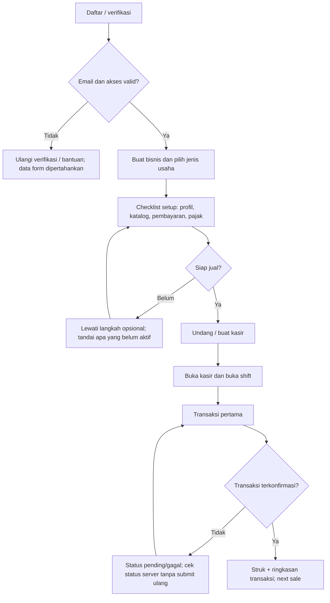
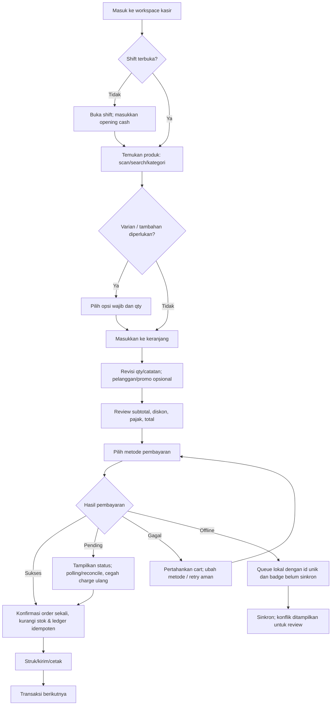

# 06 — User flows dan jalur pemulihan

Ini adalah **flow target untuk divalidasi**, bukan klaim bahwa setiap state sudah teramati. Jalur normal diturunkan dari routes/services; recovery steps adalah requirement audit. Kunci konsistensi: semua mutation berisiko uang/stok perlu idempotency/transaction boundary, tenant context tetap eksplisit, dan pengguna mendapat bukti state setelah tindakan.

## A. Owner baru sampai transaksi pertama

Recovery: email expired, tenant creation conflict, payment config invalid, produk impor sebagian gagal, kasir belum diundang, shift sudah terbuka, serta transaksi pertama offline. Checklist tidak boleh menyatakan pembayaran/izin siap hanya dari wizard yang dilewati.

## B. Penjualan cepat oleh kasir

Kasir harus bisa menyelesaikan flow dengan scanner, touch, dan keyboard. Kesalahan harga/qty harus dapat dibetulkan sebelum capture; jika provider sukses tetapi respons lokal timeout, sistem harus mencari transaksi dengan key yang sama, bukan membuat charge baru.

## C. Purchase order dan penerimaan stok

Supplier → buat PO → pilih item/satuan/biaya/qty → simpan/draft → kirim/terima sebagian → validasi actual qty & kondisi → posting movement dan cost → sisa PO tetap terbuka → terima lagi/tutup. Jika receive gagal, jangan menambah stok setengah tanpa status; retry dengan receipt ID yang sama; catat selisih dan siapa menyetujui. Sinkronisasi penjualan saat penerimaan harus menjaga stok serializable/lock policy yang dipilih.

## D. Stocktake

Pilih scope/lokasi → ambil snapshot/cutoff → hitung scan/input → review variance → alasan wajib untuk penyesuaian material → post atomic adjustment → movement history → re-open/recount bila approval ditolak. Penjualan/receiving yang terjadi setelah cutoff harus ditampilkan atau dihitung sebagai delta, bukan diam-diam tertimpa oleh hitung fisik.

## E. Tutup shift dan selisih laci

Kasir melihat ringkasan transaksi cash/noncash dan opening cash → input actual cash → sistem menghitung expected/difference → catatan wajib bila ada selisih → konfirmasi close → slip/riwayat → owner dapat review dan lihat siapa/asal penyesuaian. Jika network error setelah close, refresh harus menunjukkan shift sudah tertutup atau tetap terbuka; action aman diulang.

## F. Retur / refund

Cari transaksi asal → pilih item/qty yang belum diretur → tampilkan refund cap dan kondisi item → alasan → pilih jalur refund sesuai metode/izin → review jumlah → konfirmasi → status refund pending/success/failure. Hanya success mengubah ledger sesuai aturan; stock restoration diputuskan berdasarkan kondisi item dan tipe produk. Jika callback terlambat, order tidak boleh direfund dua kali. Kriteria detail di [11 test plan](11-acceptance-and-test-plan.md).

## G. Multi-outlet / tenant context

1. **Sebelum switch:** tampilkan nama konteks aktif dan apa yang ikut berganti (katalog, transaksi, laporan, pengguna).
2. **Switch:** hanya tenant yang authorized; confirmation hanya bila ada draft/cart atau job konteks yang belum selesai.
3. **Sesudah switch:** dashboard dan semua report/filter menampilkan nama usaha/outlet serta rentang.
4. **Aggregation (jika parent outlet diimplementasikan):** pengguna memilih scope “Semua outlet” atau satu outlet; total menandai cabang lambat/offline/yang tidak disertakan.
5. **Gagal:** izin/tenant tidak ditemukan, jangan mutasi session sebagian; beri pilihan kembali ke konteks sebelumnya.

Status sekarang memakai switching antar tenant. Langkah 4 adalah potensi fitur, bukan perilaku yang sudah terbukti.

